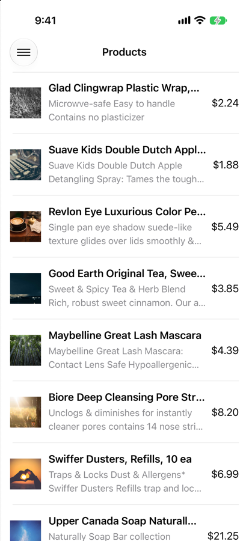
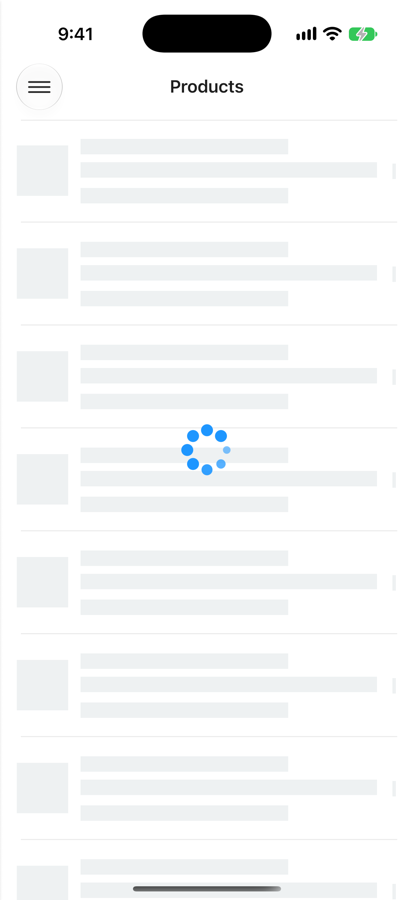
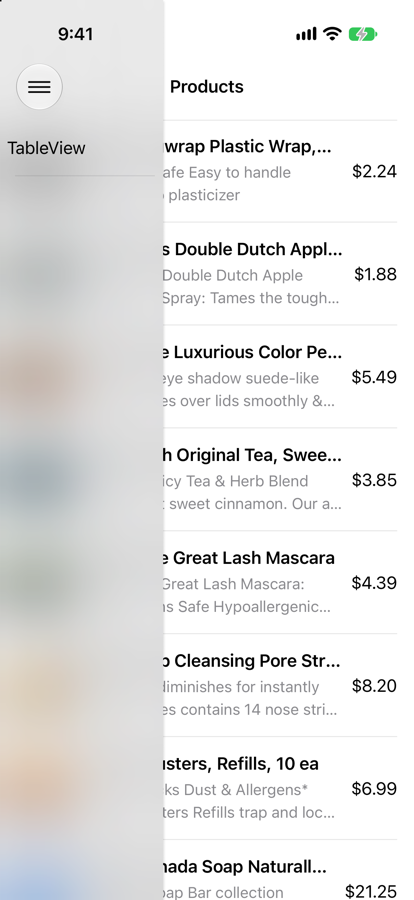

# Products Viewer (iOS)

A UIKit app that downloads a list of products from a JSON feed and shows them in a table, with a detail screen for each product and a side menu.

I built it step by step during my iOS training at nWeave. Each assignment has its own branch, and `main` holds the final version.

## Screenshots

| Products | Loading | Side menu |
|---|---|---|
|  |  |  |

| Detail (portrait) | Detail (landscape) |
|---|---|
|  |  |

## Features

- Downloads the product feed with `URLSession` and async/await, and decodes it with `Decodable`.
- Custom table cell built with Auto Layout: image on the left, title, a description of up to 2 lines, and the price on the right.
- Cleans up the feed data before showing it: removes HTML line breaks and extra spaces from descriptions, and adds the `$` to prices.
- A skeleton placeholder and an activity indicator while the products load.
- Product images are downloaded in the background and cached. Reused cells cancel the old download, so a row never shows another product's image.
- A detail screen that changes its layout between portrait and landscape.
- A side menu on the left, opened with a button or by swiping from the edge.

## Built with

| | |
|---|---|
| UI | UIKit, storyboard and code-based Auto Layout |
| Networking | `URLSession` with async/await |
| Libraries (Swift Package Manager) | [AlamofireImage](https://github.com/Alamofire/AlamofireImage) for downloading and caching images, [SkeletonView](https://github.com/Juanpe/SkeletonView) for the loading placeholder, [NVActivityIndicatorView](https://github.com/ninjaprox/NVActivityIndicatorView) for the spinner, [ENSwiftSideMenu](https://github.com/evnaz/ENSwiftSideMenu) for the side menu |

## Branches

| Branch | What it adds |
|---|---|
| `Assignment-#1---Products-Viewer` | The product list, loading states, the detail screen and image caching |
| `Assignment-#2---Create-custom-UITableView-cell` | The custom cell with image, title, description and price |
| `Assignment-#3---Integrate-the-app-into-a-side-menu` | The side menu |
| `main` | The final app, same as Assignment 3 |

## Running it

1. Open `Products Viewer.xcodeproj` in Xcode 27 or later.
2. Wait for Xcode to download the Swift packages.
3. Pick an iPhone simulator and press Run.

The product images in the feed come from picsum.photos, which serves random sample photos, so they don't match the product names.
